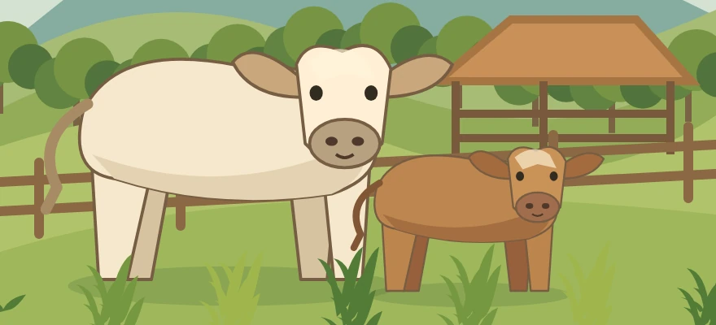
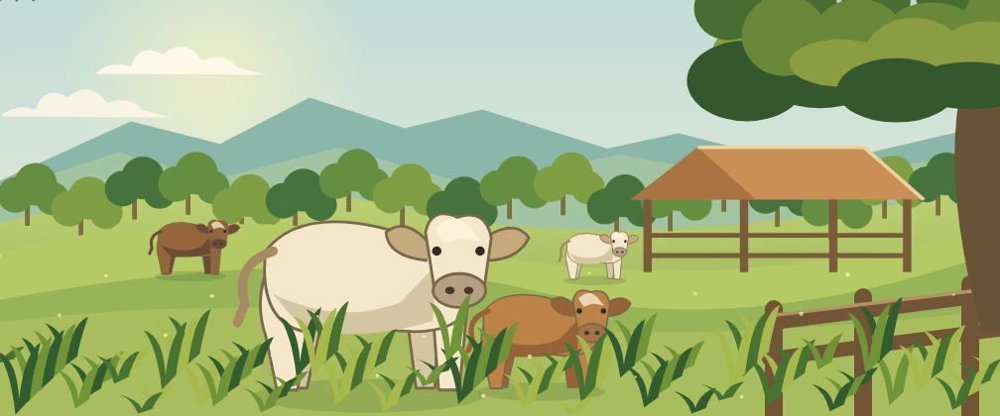
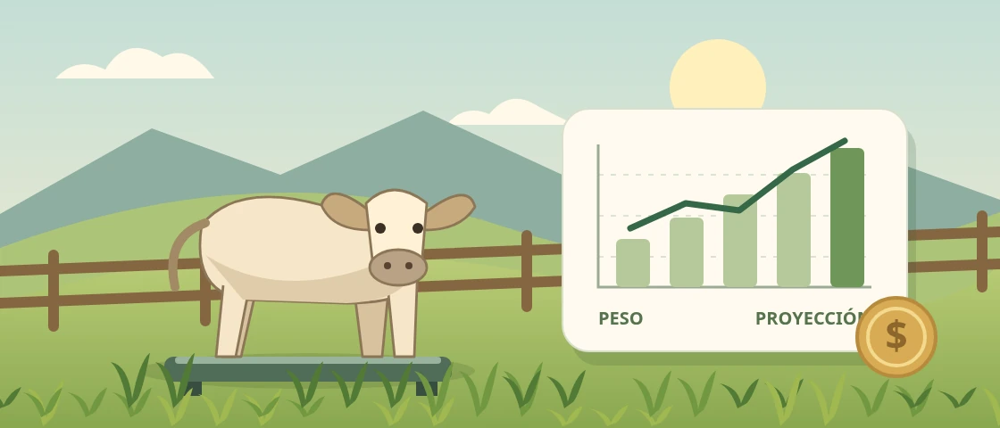
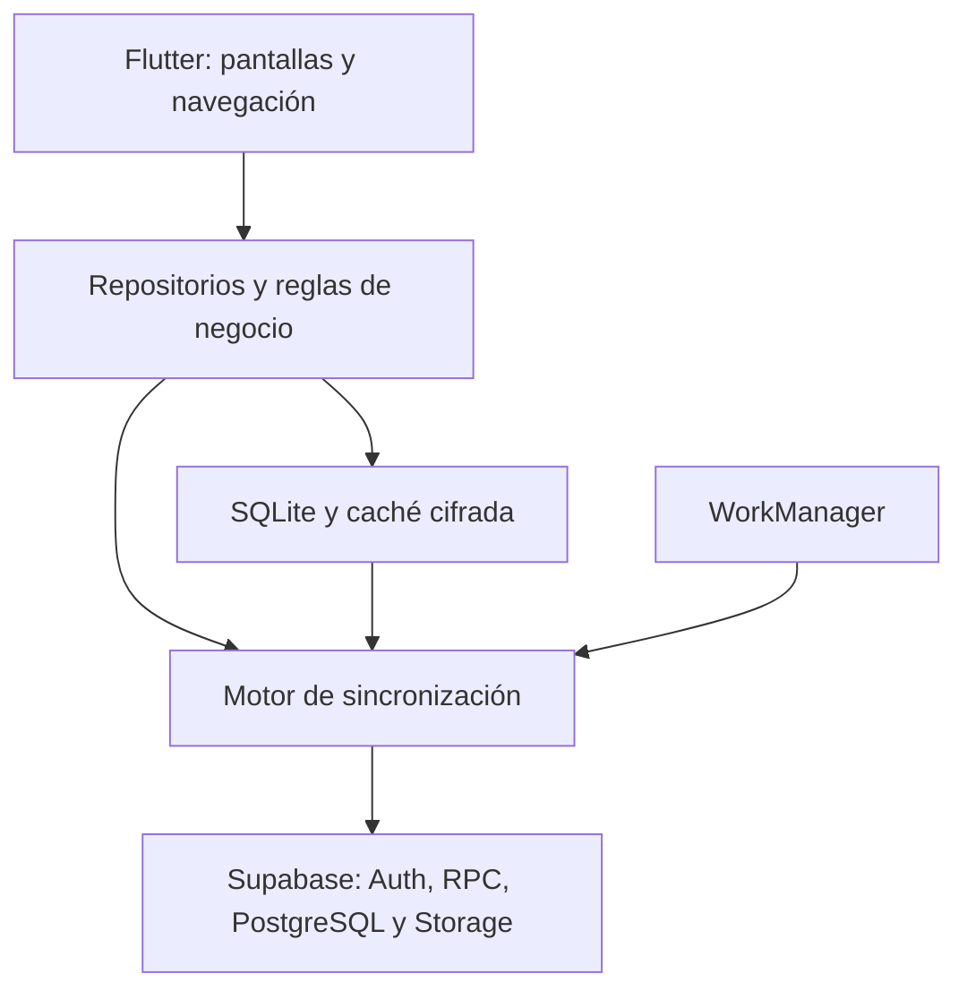

<p align="center"></p>

<h1 align="center">Ganaderov Mobile</h1>

<p align="center"><strong>El rancho en tu bolsillo.</strong><br>Gestión ganadera para Android, diseñada para trabajar también en el campo con conectividad limitada.</p>

<p align="center">
<a href="https://github.com/SkContreras/Ganaderov-Mobile/actions/workflows/flutter-checks.yml"></a>
<a href="https://github.com/SkContreras/Ganaderov-Mobile/releases"></a>
<a href="https://flutter.dev"></a>
<a href="https://supabase.com"></a>
</p>

<p align="center"><a href="https://github.com/SkContreras/Ganaderov-Mobile/releases/latest"><strong>Descargar APK publicada</strong></a> · <a href="https://github.com/SkContreras/Ganaderov">Ganaderov Web</a> · <a href="https://github.com/SkContreras/Ganaderov-Mobile/issues">Reportar un problema</a></p>

## Acerca del proyecto

Ganaderov reúne la información del ganado, sus actividades y el trabajo cotidiano del rancho en una aplicación móvil. Su objetivo es facilitar la captura en campo, mantener trazabilidad y reconciliar los cambios con el backend compartido con Ganaderov Web.

## Funcionalidades

| Módulo | Capacidades |
| --- | --- |
| Inicio | Resumen del rancho e indicadores del inventario |
| Ganado | Búsqueda por arete, nombre, raza e identificación oficial; fichas, historial y archivo |
| Fotografías | Galería privada, encuadre, foto principal y acceso rápido para compartir originales mediante Android |
| Jornadas | Registro de actividades, asistencia, cierre y reanudación según permisos |
| Análisis | Indicadores productivos, pesajes y pronósticos |
| Ajustes | Configuración del ganado, miembros y revisión de sincronización |
| Autenticación | Correo, recuperación de contraseña, Google y Facebook (requiere proveedores configurados) |
| Trabajo sin conexión | Persistencia cifrada, cola durable, dependencias y resolución de conflictos según flags y backend |

## Identidad visual

Las siguientes imágenes son **ilustraciones originales de la interfaz**, no capturas de un teléfono.

| Inicio de sesión | Inventario | Jornadas |
| --- | --- | --- |
|  |  |  |
| **Resumen** | **Análisis** | **Ajustes** |
|  |  |  |

## Instalación y estado de publicación

1. Abre [GitHub Releases](https://github.com/SkContreras/Ganaderov-Mobile/releases/latest).
2. Descarga el APK de producción y su archivo SHA-256.
3. Verifica la descarga con `sha256sum -c app-production-release.apk.sha256` desde la carpeta de descarga.
4. Instala únicamente el archivo obtenido del repositorio oficial. Android puede pedir autorización para instalar desde esa fuente.

El APK publicado y el código de `main` pueden corresponder a revisiones distintas. Consulta las notas de cada release; las funciones nuevas de la rama principal, incluida la opción de compartir fotos, no están garantizadas en una APK anterior. La disponibilidad de la sincronización avanzada depende de los parámetros de compilación y de las migraciones del backend. Consulta [preparación para producción](docs/release-readiness.md).

## Compartir una fotografía

En **Ganado**, busca el animal y pulsa el icono de compartir en su tarjeta o abre su galería. Elige la fotografía y selecciona una aplicación instalada en Android. Se comparte el original, no un enlace público; puede contener metadatos de cámara. Sin conexión, la fotografía debe estar disponible localmente. [Detalles y validación](docs/photo-sharing.md).

## Arquitectura y tecnología

Flutter · Dart · Riverpod · GoRouter · Supabase · Drift/SQLite · PointyCastle · WorkManager.



```text
lib/
  main.dart              # Inicialización y recuperación de arranque
  app.dart               # Aplicación
  core/
    config/              # Configuración y sesión
    database/            # Persistencia y cifrado
    router/              # Navegación
    sync/                # Colas, conflictos y entrega
    theme/               # Identidad visual
  features/
    auth/ dashboard/ livestock/ journeys/ analysis/ settings/
  shared/                # Componentes reutilizables
android/                 # Integración nativa y variantes
assets/                  # Iconos e ilustraciones
backend/                 # SQL complementario
contracts/sync/v1/       # Contrato de sincronización
docs/                    # Guías técnicas
test/                    # Pruebas automatizadas
tool/                    # Herramientas de desarrollo
```

Las funcionalidades se organizan en capas `data`, `domain` y `presentation` cuando corresponde.

## Desarrollo local

Requisitos: Git, Flutter compatible con `pubspec.yaml`, Android SDK, Java 17 y un backend Supabase autorizado. En Linux, instala SQLite del sistema para las pruebas.

```sh
git clone https://github.com/SkContreras/Ganaderov-Mobile.git
cd Ganaderov-Mobile
cp .env.example .env
flutter pub get
./tool/flutter_with_env.sh run
```

Completa `.env` con la URL y clave **publicable** de tu proyecto de pruebas. No uses una clave `service_role` ni `secret`. Las políticas RLS y permisos de RPC deben proteger los datos en el servidor.

```sh
flutter analyze --no-fatal-infos
flutter test
```

### Compilación y firma

```sh
./tool/flutter_with_env.sh build apk --release --flavor production
```

El archivo se genera en `build/app/outputs/flutter-apk/app-production-release.apk`. Configura `android/key.properties` con un keystore autorizado antes de distribuirlo; sin él, la compilación release queda sin firmar. Conserva la misma clave para actualizar instalaciones existentes. No compartas contraseñas ni keystores.

Las opciones `SYNC_UNIVERSAL_V1`, `SYNC_INCREMENTAL_V1`, `SYNC_BACKGROUND_V1`, `SYNC_JOURNEY_RPC_V1` y `SYNC_EVENT_RPC_V1` se fijan al compilar y están desactivadas por defecto. Activa únicamente las compatibles con un backend previamente validado. La variante `d4test` usa un backend desechable y no debe conectarse a producción.

## Documentación técnica

- [Desarrollo y configuración de distribución](docs/development.md)
- [Captura universal sin conexión](docs/universal-completion.md)
- [Sincronización incremental](docs/incremental-sync-v1.md)
- [Entrega en segundo plano](docs/background-delivery-v1.md)
- [Cifrado local](docs/local-encryption-v2.md)
- [Fotografías y encuadre](docs/photo-d4.md)
- [Compartir fotografías](docs/photo-sharing.md)
- [APK de pruebas](docs/android-test-apk.md)
- [Preparación para producción](docs/release-readiness.md)

## Colaboración y seguridad

Consulta [CONTRIBUTING.md](CONTRIBUTING.md) para contribuir, [CHANGELOG.md](CHANGELOG.md) para los cambios y [SECURITY.md](SECURITY.md) para reportar vulnerabilidades sin publicar información sensible.

## Agradecimientos

A los ganaderos que inspiran el desarrollo de herramientas útiles para el trabajo de campo y a las comunidades de Flutter, Dart, Supabase, SQLite y las bibliotecas de código abierto utilizadas en el proyecto.

**Proyecto mantenido por [SkContreras](https://github.com/SkContreras).** No se ha especificado una licencia pública para este repositorio; la visibilidad del código no constituye por sí sola permiso de redistribución.
